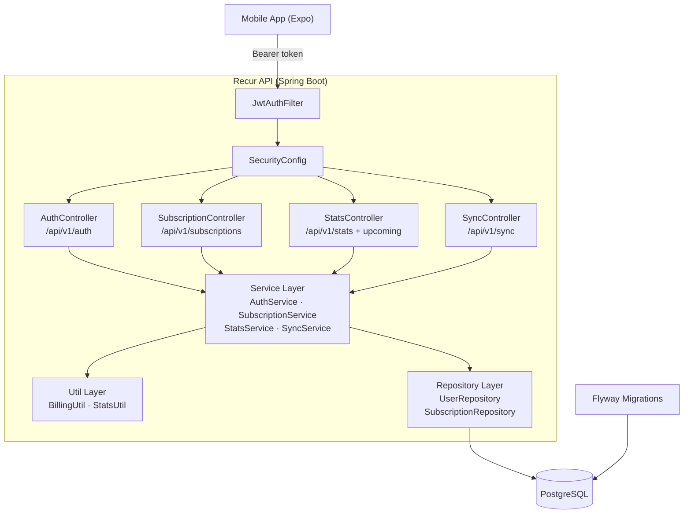

# Recur API

REST backend for **[Recur](https://github.com/Mosugar/recur)** — a minimalist subscription tracker mobile app built with Expo / React Native.

## Features

- **Auth** — register, login, and profile via JWT (HS256)
- **Subscriptions CRUD** — create, list (with active/category/sort filters), update, delete
- **Upcoming payments** — subscriptions due in the next N days with computed next-payment-date
- **Stats** — monthly/yearly totals and per-category breakdown (main currency only)
- **Sync** — offline-first bulk upsert with last-write-wins semantics for the mobile app
- **Ownership enforcement** — accessing another user's resource returns 404
- **OpenAPI / Swagger UI** — interactive docs at `/swagger-ui.html`
- **Actuator** — health check at `/actuator/health`

## Stack

| Layer | Technology |
|---|---|
| Language | Java 21 |
| Framework | Spring Boot 4.1.2 |
| Security | Spring Security + jjwt 0.12.6 (JWT HS256) |
| Persistence | Spring Data JPA + PostgreSQL 17 + Flyway |
| Mapping | MapStruct 1.6.3 |
| API Docs | springdoc-openapi 3.2.0 (Swagger UI) |
| Tests | JUnit 5 + Mockito + MockMvcTester + Testcontainers 2.x |
| Coverage | JaCoCo |
| Build | Maven (wrapper included) |
| Container | Docker (multi-stage) + Docker Compose |
| CI | GitHub Actions |

## Architecture



## Getting started

### With Docker (recommended)

```bash
# 1. Copy and fill in the environment file
cp .env.example .env
# Edit .env — set DB_PASSWORD and JWT_SECRET (min 32 chars)

# 2. Start everything
docker compose up --build

# 3. Open Swagger UI
open http://localhost:8080/swagger-ui.html
```

> `docker compose up` starts PostgreSQL first (with a healthcheck), then the API.
> Flyway runs migrations automatically on startup.

### Running locally (no Docker)

**Prerequisites:** Java 21, Maven, a running PostgreSQL instance.

```bash
# 1. Create the database
psql -U postgres -c "CREATE DATABASE recur; CREATE USER recur WITH PASSWORD 'recur'; GRANT ALL ON DATABASE recur TO recur;"

# 2. Set environment variables (or use the dev profile which has defaults)
export JWT_SECRET="dev-secret-key-change-in-production-must-be-long-enough-for-hs256"

# 3. Run with the dev profile
./mvnw spring-boot:run -Dspring-boot.run.profiles=dev
```

## Running tests

```bash
# All tests (requires Docker for Testcontainers integration tests)
./mvnw verify

# Unit tests only (no Docker needed)
./mvnw test -Dtest="!RepositoryIntegrationTest"

# Generate JaCoCo coverage report (target/site/jacoco/index.html)
./mvnw verify
```

## API reference

All endpoints (except auth and health) require `Authorization: Bearer <token>`.

### Auth

| Method | Path | Description |
|--------|------|-------------|
| `POST` | `/api/v1/auth/register` | Register; returns JWT |
| `POST` | `/api/v1/auth/login` | Login; returns JWT |
| `GET`  | `/api/v1/auth/me` | Current user profile |

```bash
# Register
curl -s -X POST http://localhost:8080/api/v1/auth/register \
  -H "Content-Type: application/json" \
  -d '{"email":"you@example.com","password":"secret123","displayName":"You"}'

# Login
TOKEN=$(curl -s -X POST http://localhost:8080/api/v1/auth/login \
  -H "Content-Type: application/json" \
  -d '{"email":"you@example.com","password":"secret123"}' | jq -r .token)
```

### Subscriptions

```bash
# Create
curl -s -X POST http://localhost:8080/api/v1/subscriptions \
  -H "Authorization: Bearer $TOKEN" \
  -H "Content-Type: application/json" \
  -d '{
    "name": "Netflix",
    "priceCents": 1599,
    "currency": "EUR",
    "cycle": "MONTHLY",
    "firstPaymentDate": "2024-01-15",
    "category": "STREAMING",
    "color": "#E50914",
    "reminderEnabled": false,
    "active": true
  }'

# List (with filters)
curl -s "http://localhost:8080/api/v1/subscriptions?active=true&sort=price" \
  -H "Authorization: Bearer $TOKEN"

# Upcoming payments in the next 30 days
curl -s "http://localhost:8080/api/v1/subscriptions/upcoming?days=30" \
  -H "Authorization: Bearer $TOKEN"
```

### Stats

```bash
curl -s http://localhost:8080/api/v1/stats/summary \
  -H "Authorization: Bearer $TOKEN"
# → {"monthlyTotalCents":1599,"yearlyTotalCents":19188,"activeCount":1,"excludedCount":0}

curl -s http://localhost:8080/api/v1/stats/by-category \
  -H "Authorization: Bearer $TOKEN"
# → [{"category":"STREAMING","monthlyAmountCents":1599,"percentage":100.0}]
```

### Sync (offline-first)

```bash
curl -s -X POST http://localhost:8080/api/v1/sync \
  -H "Authorization: Bearer $TOKEN" \
  -H "Content-Type: application/json" \
  -d '{
    "subscriptions": [{
      "id": "550e8400-e29b-41d4-a716-446655440000",
      "name": "Spotify",
      "priceCents": 999,
      "currency": "EUR",
      "cycle": "MONTHLY",
      "firstPaymentDate": "2024-01-01",
      "category": "MUSIC",
      "color": "#1DB954",
      "reminderEnabled": false,
      "active": true,
      "updatedAt": "2024-06-01T12:00:00Z"
    }]
  }'
# → {"subscriptions":[...],"upsertedCount":1}
```

## Environment variables

| Variable | Required | Default | Description |
|----------|----------|---------|-------------|
| `JWT_SECRET` | Yes | — | HS256 signing key (min 32 chars) |
| `JWT_EXPIRATION_MS` | No | `86400000` | Token TTL in ms (24 h) |
| `DB_HOST` | No | `localhost` | PostgreSQL host |
| `DB_PORT` | No | `5432` | PostgreSQL port |
| `DB_NAME` | No | `recur` | Database name |
| `DB_USER` | No | `recur` | Database user |
| `DB_PASSWORD` | Yes | — | Database password |
| `SERVER_PORT` | No | `8080` | HTTP port |

See [`.env.example`](.env.example) for a template.
